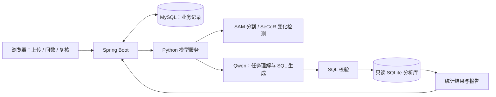

# GeoPatrol · 巡变智判

**SAM 遥感分割与变化分析平台**

面向课题组遥感影像的建筑提取与变化分析，整合影像上传、批量预测、结果存储、自然语言问数、人工精修与报告导出。

本仓库提供核心源码，**不包含遥感数据集、业务数据库、用户记录或模型权重**。当前为单 Java 应用与单 GPU Python 模型服务架构。

## 主要功能

- **建筑分割**：接入 SAM ViT-L 与 SCFP 结构引导频率提示模块，输出建筑掩膜、覆盖比例和连通区域统计。保留 Adapter、提示分支及 Mask Decoder 的训练代码。
- **变化检测**：接入 SeCoR 双时相变化检测发布模型，支持配对影像、切块推理、掩膜合并和变化统计。
- **异步推理**：Spring Boot 与 MySQL 持久化批次、任务和执行尝试，通过心跳续租、过期回收及执行标识校验处理任务恢复与迟到结果。
- **自然语言问数**：本地 Qwen2.5-Coder-7B 生成 SQL，经 SQLGlot 语法树与查询范围校验，在隔离的只读 SQLite 分析库执行；支持聊天、口径澄清、连续追问和有限修复。
- **协作复核**：支持账号与批次权限、多边形精修、原始预测与人工修正两种结果口径，以及版本冲突检查。
- **分析报告**：支持查询方案确认、多步骤统计、结果引用检查与报告导出。

建筑量为过滤小碎片后的连通区域估计，尚不具备实例分割及跨图地理去重能力；单时相分割不能推断新增或拆除数量。没有地面分辨率时，像素量不换算为真实地面面积。

## 系统流程

MySQL 保存业务记录；分析库由已发布、已授权的批次结果构建。大模型不直接对业务 MySQL 执行任意 SQL。

## 源码导航

| 目录 / 文件 | 内容 |
| --- | --- |
| `backend-java/src/main/java/` | 认证、授权、批次、任务调度、结果与复核接口 |
| `backend-java/src/main/resources/static/` | 正式巡检控制台、管理页与分析页，不含历史样本数据 |
| `backend-java/src/main/resources/schema.sql` | 数据库建表脚本，业务数据需自行准备 |
| `tools/java_backend_bridge.py` | Java 与 Python 模型、聊天、问数的桥接服务 |
| `tools/model_sql.py`、`query_*.py` | SQL 生成、查询契约、状态、澄清及校验 |
| `tools/conversation_assistant.py`、`analysis_tasks.py` | 对话路由与多步骤分析 |
| `segmentation/` | 建筑分割推理、统计口径和结果持久化 |
| `model_sources/sam_scfp/source_snapshot/` | 冻结的 SAM/SCFP 模型与训练源码 |
| `model_sources/change_detection/` | 变化检测发布推理脚本 |
| `tools/train_query_update_qlora.py` | 区域排名追问状态的 QLoRA 训练脚本 |
| `tests/`、`backend-java/src/test/` | Python、前端与 Java 测试源码 |

QLoRA 仅用于原区域排名追问状态更新，**不是 SQL 生成模型的微调**；适配器权重不随源码提供。知识检索、Agent 等历史实验不等于当前正式业务链路，不能据代码中的可选分支推断为默认能力。

## 环境与部署准备

- Java 21、Maven、MySQL；Python 3.11 与 NVIDIA CUDA 环境。
- 现有推理环境的实际依赖版本见 [runtime-versions.json](deploy/runtime-versions.json)。上游 SAM 的历史 requirements 仅作来源参考，不应直接覆盖该环境。
- 按 [backend.env.example](deploy/backend.env.example) 设置数据库连接、内部令牌、存储和状态目录。示例只有占位符，应使用自己的凭据。
- 当前正式入口为 `http://127.0.0.1:8786/`；内部 Python 服务为 `8787`，默认仅绑定本机。

### 启动前必须完成

1. **配置数据库与运行目录。** 准备空的业务库，设置示例中的 `XB_DB_*`、`XB_STORAGE_ROOT`、`XB_STATE_ROOT` 和 `XB_INTERNAL_TOKEN`。当前不提供原历史样本库，保持 `XB_ARCHIVE_FILE` 为空。
2. **配置模型。** 在 `tools/java_backend_bridge.py` 的 `RELEASE/REGISTRY` 中配置 SeCoR TorchScript 权重；在 `tools/sam_segmentation_runtime.py` 的 `RELEASE` 中配置 SAM 发布目录。
3. **恢复 SAM 发布目录。** `model_sources/sam_scfp/` 含 `source_snapshot` 与 YAML 配置；另行补齐基础 SAM ViT-L 权重及 `training/best_adapters.pth`，并调整 YAML 内的权重、数据路径。
4. **准备本地 Qwen。** 另行下载模型权重到本地缓存。原排名状态适配器为可选，缺少适配器权重时不应假定已经启用。
5. **调整启动路径。** 原部署基于 Windows + WSL，启动脚本保留了部署机的目录与 Python 路径。迁移前调整 `start_java_backend.cmd`、`backend-java/scripts/start.sh`、`start-python.sh`、`maven.sh` 中的本机路径，并准备其读取的环境文件。

配置完成后可按 [Java 后端说明](backend-java/README.md) 启动，在管理页创建自己的批次并上传影像。不要直接打开磁盘上的 HTML 文件作为完整系统运行。

## 验证与边界

本次源码整理完成了 **173 个 Python 文件的语法检查、30 个 JS/CJS 文件的语法检查及源码包完整性检查**，记录见 [source-package-checks.json](docs/source-package-checks.json)。这些检查不等于空库部署验证，也不是模型准确率评测。

保留测试中有些依赖原始数据、专用数据库或模型，需补齐对应条件后运行；数据与权重没有随仓库发布。

变化检测发布目录只找到了推理脚本与 TorchScript 权重，本仓库没有声称提供完整的 SeCoR 训练工程。SAM 来源说明保留于 [上游 README](model_sources/sam_scfp/upstream/README.md)，模型代码保留原注释。
